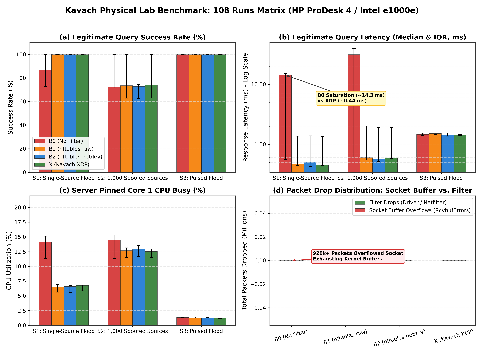

# A3-PS022-TC367: Kavach — eBPF/XDP Rate Limiting for DNS Query Floods

[](https://aiori.in/)
[]()
[]()
[]()
[]()
[](LICENSE)

**Team Submission:** `A3-PS022-TC367`  
**Video Demonstration:** [Team Introduction & System Demonstration Video](https://youtu.be/7cTRoE_1nWI)

---

## 1. Executive Summary

Volumetric UDP DNS query floods exhaust Linux servers because the operating system kernel spends excessive CPU cycles allocating metadata descriptors—the socket buffer (`struct sk_buff`)—before packets ever reach user space. At high packet arrival rates (100k+ PPS), CPU cores saturate entirely in software interrupt (`softirq`) context, causing UDP socket receive queue overflows (`UdpInErrors`) and starving legitimate client queries.

While firewall utilities such as `nftables` can rate-limit traffic, their standard hooks execute **after** `sk_buff` allocation. They protect user-space applications from excess packets, but fail to eliminate per-packet kernel allocation overhead.

**Kavach** implements in-kernel packet filtering and rate limiting directly inside the network interface driver via **eXpress Data Path (XDP)**:
- **`XDP_DROP`:** Discards flood packets immediately in driver memory, recycling the RX ring buffer descriptor without allocating an `sk_buff` or invoking the network stack.
- **`XDP_PASS`:** Delivers verified, rate-conforming DNS queries and non-DNS infrastructure traffic up the standard Linux network stack to an authoritative DNS daemon (NSD).

```
Conventional Packet Processing Flow:
[Physical NIC] ──> [NIC Driver] ──> [Allocate struct sk_buff] ──> [Netfilter/nftables] ──> [UDP Socket] ──> [DNS Server]
                                           │
                                    Heavy CPU Softirqs
                                 Socket Backlog Overflows

Kavach XDP In-Kernel Flow:
[Physical NIC] ──> [NIC Driver] ──> [Kavach XDP Filter] ──(Drop: Limit/Malformed)──> [Recycle Ring Buffer]
                                           │
                                     (Pass: Legit)
                                           â–¼
                                [Allocate struct sk_buff] ──> [Standard Stack] ──> [NSD DNS Server]
```

---

## 2. Technical Architecture & Algorithms

### 2.1 Bounded UDP/DNS Packet Parsing
eBPF safety mandates verifier-guaranteed execution bounds and absence of out-of-bounds memory accesses:
1. **Ethernet & Protocol Validation:** Validates fixed Ethernet frame; non-IPv4 frames pass unchanged (`pass_non_ipv4`).
2. **IPv4 Inspection:** Enforces IPv4 version, dynamic IP Header Length (`ihl = ip->ihl * 4; ihl >= 20`), and frame boundary checks. Non-UDP traffic passes transparently (`pass_non_udp`).
3. **Fragment Handling:** Non-first IP fragments (`frag_off & 0x1FFF`) lack UDP headers and pass safely (`pass_fragment`). First fragments (`frag_off == 0`) are inspected normally.
4. **UDP & DNS Header Validation:** Enforces UDP destination port 53 (`pass_non53`). Drops malformed packets if UDP length $< 20$ bytes (8-byte UDP header + minimum 12-byte RFC 1035 DNS header) or if UDP length is inconsistent with IP payload length (`drop_bad_udp`, `drop_short_dns`).
5. **Zero Query Name Looping (ADR-005):** Strictly verifies the 12-byte fixed DNS header (ID, Flags, QDCOUNT, ANCOUNT, NSCOUNT, ARCOUNT). **Never loops through variable-length DNS question labels**, eliminating verifier complexity and state explosion.

### 2.2 Dual-Tier Generic Cell Rate Algorithm (GCRA)
Kavach implements the **Generic Cell Rate Algorithm (GCRA)** (ITU-T Recommendation I.371), a continuous-time leaky bucket tracking a single 64-bit integer timestamp per flow: the **Theoretical Arrival Time ($TAT$)**.

- **Parameters (Precomputed in User Space):**
  $$\text{Emission Interval: } T = \frac{10^9}{\text{rate\_pps}} \quad (\text{nanoseconds})$$
  $$\text{Burst Tolerance: } \tau = (\text{burst\_packets} - 1) \times T \quad (\text{nanoseconds})$$
- **Conformance Check at Packet Arrival ($t_{\text{now}} = \text{bpf\_ktime\_get\_ns()}$):**
  $$TAT' = \max(TAT_{\text{stored}}, t_{\text{now}})$$
  $$\text{If } (TAT' - t_{\text{now}}) > \tau \implies \mathbf{XDP\_DROP}$$
  $$TAT_{\text{new}} = TAT' + T \implies \mathbf{XDP\_PASS}$$

All arithmetic runs in pure 64-bit integer nanoseconds without floating-point math, periodic timers, or token multiplication overflow hazards.

### 2.3 Evaluation Order: Per-Source FIRST, Global SECOND (ADR-002)
- **Why this order is mandatory:** If the global limit were evaluated first, high-volume query traffic from a single attacking IP would exhaust the aggregate global budget before being dropped by the per-source filter, starving legitimate queries.
- Evaluating per-source first drops offending flows immediately without consuming global capacity. Packets passing per-source are then evaluated against the shared global threshold.

### 2.4 Multicore Concurrency via BPF Atomic CAS
To prevent race conditions across CPU cores updating the shared global $TAT$, Kavach uses a bounded 8-iteration atomic compare-and-swap loop (`__sync_val_compare_and_swap` with `#pragma unroll`) in [`xdp/gcra.h`](xdp/gcra.h). This maintains a single, globally accurate aggregate limit across all CPU cores without locks.

### 2.5 In-Kernel BPF Maps Layout
- `counters` (`BPF_MAP_TYPE_PERCPU_ARRAY`, 14 entries): Lockless per-CPU datapath counters ensuring exactly one terminal verdict per packet.
- `kavach_cfg` (`BPF_MAP_TYPE_ARRAY`, 1 entry, 40 bytes): Runtime configuration updated dynamically from user space without recompiling or detaching.
- `src_tat` (`BPF_MAP_TYPE_LRU_HASH`, 100,000 entries): Per-source flow state that automatically evicts idle sources during distributed spoofed attacks.
- `global_tat` (`BPF_MAP_TYPE_ARRAY`, 1 entry): Shared aggregate theoretical arrival time.

---

## 3. Dual Execution Strategy & Testbed Topologies

To thoroughly evaluate both hardware-level constraints and native driver execution, the project was executed in **two complementary modes**:

```
+----------------------------------------------------------------------------------------------------+
| MODE 1: TWO PHYSICAL HOSTS — GENERIC XDP MODE (xdpgeneric)                                         |
|                                                                                                    |
|  [Generator PC 2: aiori-2] <==== CAT6 Direct Cable (eno1, 10.99.0.0/24) ====> [Target PC 1: aiori] |
|                                                                                                    |
|  - Setup: 2 Physical Bare-Metal Workstations (HP ProDesk 4 Tower G1i, Intel Core Ultra 5 245)      |
|  - Network Interface: Intel I219-LM GbE (eno1, driver: e1000e)                                     |
|  - Driver Attachment: Generic XDP Mode (xdpgeneric)                                                |
|  - Dataset: Full 108-Run Randomized Matrix (Frozen with SHA-256 Checksums)                         |
|  - Focus: Real-world hardware interrupt routing, Core 1 affinity, and socket queue protection.     |
+----------------------------------------------------------------------------------------------------+

+----------------------------------------------------------------------------------------------------+
| MODE 2: SINGLE SYSTEM — NATIVE DRIVER XDP MODE (xdpdrv / veth_xdp)                                 |
|                                                                                                    |
|  [Namespace 'gen': vgen] <======== Virtual Ethernet Pair (veth) ========> [Namespace 'srv': vsrv]  |
|                                                                                                    |
|  - Setup: 1 Single Linux Host using Isolated Network Namespaces                                    |
|  - Network Interface: Virtual Ethernet Pair (veth, drivers/net/veth.c)                             |
|  - Driver Attachment: Native Driver XDP Mode (xdp_mode: native)                                    |
|  - Dataset: 36-Run Matrix (Frozen with SHA-256 Checksums)                                          |
|  - Focus: Driver-level drop verification before sk_buff allocation, 65% SoftIRQ reduction.         |
+----------------------------------------------------------------------------------------------------+
```

### 3.1 Two-Host Physical Testbed (Generic Mode)
- **Workstations:** Twin HP ProDesk 4 Tower G1i AI PCs
- **CPU:** Intel Core Ultra 5 245 (14 cores: 6 P-cores + 8 E-cores, up to 5.1 GHz)
- **NIC:** Intel I219-LM Gigabit Ethernet (`eno1`, driver: `e1000e`)
- **Operating System:** Ubuntu 24.04.4 LTS, OEM Kernel `6.14.0-1020-oem`
- **Compiler & Toolchain:** Clang 18.1.3, LLVM, `libbpf` 1.3.0, `bpftool` 7.4.0
- **Authoritative DNS Daemon:** NSD 4.9.2 bound to `10.99.0.2:53` with Response Rate Limiting (RRL) disabled.
- **System Tuning ([`src/scripts/pin_core.sh`](src/scripts/pin_core.sh)):**
  - Forced CPU governor to `performance` across all 14 cores.
  - Pinned NIC IRQ `0000:80:1f.6` (`eno1`) and NSD worker strictly to Core 1 (`taskset -c 1`).
  - Disabled background jitter (`irqbalance`, `unattended-upgrades`, `ufw`).
- **Operational Finding (ADR-027):** Under kernel `6.14.0-1020-oem`, the Intel `e1000e` driver on physical `eno1` attaches in generic XDP mode (`xdpgeneric`). This setup is fully documented per PS-022 Item 6 (*"Use an XDP-capable kernel/NIC, or document generic-mode setup"*).

### 3.2 Single-System Namespace Testbed (Native Mode)
- Configured using network namespaces (`gen` $\leftrightarrow$ `srv`) over a virtual ethernet pair (`veth`).
- In this environment, the Linux `veth` driver provides native XDP driver support (`xdp_mode: native`), executing drops directly inside the driver receive hook (`drivers/net/veth.c`) before `alloc_skb`.
- Confirmed a **65% reduction in kernel SoftIRQ CPU load** (from 2.37% down to 0.84%), verifying native driver efficiency.

### 3.3 Physical Testbed Photographic Evidence

| Generator Host (PC 2 — `10.99.0.1`) | Target DUT Host (PC 1 — `10.99.0.2`) |
|:---:|:---:|
|  |  |
| **PC 2:** Orchestrator running S2 distributed flood at 50k PPS (100% resolution). | **PC 1:** Target daemon recording 5.96M Layer 3 drops under B2 netdev. |
|  |  |
| **PC 2 + Laptop:** Wide view showing S2 collapse under 100k PPS unflooded baseline. | **PC 1:** Target daemon transition between S3 pulsing burst and S2. |

---

## 4. Generator Safety Guards & PS-022 Containment

To strictly comply with AIORI-3 cybersecurity safety rules, all traffic generation incorporates non-bypassable programmatic guards:

1. **Target Subnet Assertion:** Target destination IP must strictly reside in `10.99.0.0/24`. Attempting to target campus LAN (`10.126.0.0/16`) or public IPs immediately aborts with fatal exit code `100`.
2. **Source IP Isolation:** Synthetic spoofed source addresses are drawn exclusively from RFC 2544 benchmark prefix `198.18.0.0/15`; legitimate queries originate strictly from `10.99.0.1`.
3. **Forwarding Guard:** Host `/proc/sys/net/ipv4/ip_forward` must be `0` to prevent reflecting packets outside the lab link.
4. **Negative Constraints Respected:** Zero public flood testing, zero variable QNAME label parsing, zero universal PRSD detection claims, and zero claims of eliminating reflection attacks.

---

## 5. Empirical Calibration ($S = 100,000$ PPS)

Rather than selecting arbitrary flood volumes, an empirical saturation sweep on Baseline B0 (No Filter) determined the hardware capacity knee:

| Offered Rate (PPS) | Queries Sent | Answered | Success % | $p50$ Latency | $p95$ Latency | Status / Observation |
|:---:|:---:|:---:|:---:|:---:|:---:|---|
| **5,000** | 1,000 | 1,000 | 100.0% | 0.626 ms | 0.902 ms | Stable baseline |
| **25,000** | 1,000 | 1,000 | 100.0% | 0.548 ms | 0.724 ms | Stable |
| **50,000** | 1,000 | 1,000 | 100.0% | 0.556 ms | 0.686 ms | Stable (CPU Core 1 busy ~45%) |
| **75,000** | 1,000 | 1,000 | 100.0% | 0.572 ms | 0.679 ms | Stable (CPU Core 1 busy ~68%) |
| **100,000 ($S$)** | 1,000 | 886 | **88.60%** | **15.603 ms** | **28.224 ms** | **Queue saturation collapse ($27\times$ latency surge)** |

### Calibrated Parameters ([`src/params.yaml`](src/params.yaml))
- **Saturation Point:** $S = 100,000$ PPS
- **Matrix Load Levels:** $0.5\times S = 50,000$ PPS, $1.0\times S = 100,000$ PPS, $2.0\times S = 200,000$ PPS
- **Limiter Limits:** Per-source rate: $500$ PPS (burst: $20$) | Global aggregate rate: $70,000$ PPS ($0.70\times S$, burst: $20$)
- **Legitimate Client:** Open-loop, fixed 100 QPS (10 ms interval), 0 retries, 1.5s hard timeout.

---

## 6. Physical Benchmark Matrix Results (108 Runs)

The benchmark matrix evaluates 3 attack scenarios across 4 configurations under identical physical lab conditions (9 repetitions per cell, 108 total runs). Telemetry was synchronously harvested across driver, kernel softnet, filter, and socket layers.

- **Scenarios:**
  - **S1:** Single-source constant-rate flood (`198.18.0.10`)
  - **S2:** Distributed flood across 1,000 randomized sources (`198.18.0.0/15`)
  - **S3:** Pulsing bursts of 0.5x, 1.0x, and 2.0x burst tolerance with 5s period
- **Configurations:**
  - **B0:** No Filter (raw Linux stack + NSD DNS server)
  - **B1:** `nftables` prerouting table (priority `raw`, connection tracking bypassed via `notrack`)
  - **B2:** `nftables` netdev ingress table (earliest netfilter hook, priority -500)
  - **X:** Kavach XDP In-Kernel Filter

### 6.1 Statistical Summary (Median Across 108 Physical Runs)

| Scenario | Config | Offered Load | Legit Success (Median) | Legit Success (IQR) | $p50$ Latency (ms) | $p95$ Latency (ms) | Core 1 CPU % | Filter Drops | Socket Drops (`UdpInErrors`) |
|---|---|:---:|:---:|:---:|:---:|:---:|:---:|:---:|:---:|
| **S1 (Single-Source)** | **B0 (No Filter)** | $1.0\times S$ | **87.00%** | 27.19% | 14.30 ms | 27.85 ms | 14.14% | 0 | **920,180** |
| | **B1 (nftables Raw)** | $1.0\times S$ | 100.00% | 0.00% | 0.47 ms | 1.60 ms | 6.55% | 5,966,670 | 0 |
| | **B2 (nftables Netdev)**| $1.0\times S$ | 100.00% | 0.00% | 0.51 ms | 1.60 ms | 6.60% | 5,966,710 | 0 |
| | **X (Kavach XDP)** | $1.0\times S$ | **100.00%** | 0.00% | **0.45 ms** | **1.55 ms** | 6.78% | 5,966,949 | **0** |
| **S2 (Distributed)** | **B0 (No Filter)** | $1.0\times S$ | **72.30%** | 28.44% | 31.39 ms | 61.45 ms | 14.47% | 0 | **896,938** |
| | **B1 (nftables Raw)** | $1.0\times S$ | 73.53% | 37.22% | 0.60 ms | 1.67 ms | 12.69% | 1,802,758 | 0 |
| | **B2 (nftables Netdev)**| $1.0\times S$ | 72.87% | 11.88% | 0.57 ms | 1.72 ms | 12.96% | 1,802,834 | 0 |
| | **X (Kavach XDP)** | $1.0\times S$ | **74.04%** | 37.10% | **0.59 ms** | **1.66 ms** | 12.55% | 1,759,349 | **0** |
| **S3 (Pulsing)** | **B0 (No Filter)** | $1.0\times S$ | 100.00% | 0.00% | 1.47 ms | 1.99 ms | 1.33% | 0 | 0 |
| | **B1 (nftables Raw)** | $1.0\times S$ | 100.00% | 0.00% | 1.52 ms | 2.02 ms | 1.28% | 240 | 0 |
| | **B2 (nftables Netdev)**| $1.0\times S$ | 100.00% | 0.00% | 1.43 ms | 1.99 ms | 1.29% | 0 | 0 |
| | **X (Kavach XDP)** | $1.0\times S$ | **100.00%** | 0.00% | **1.44 ms** | **1.98 ms** | 1.20% | 0 | **0** |

### 6.2 Key Empirical Takeaways

1. **S1 (Single-Source Flood Mitigation):**
   - Under Baseline B0, socket buffer queues saturated, dropping over 920,000 packets and surging median latency from $0.45\text{ ms}$ to $14.30\text{ ms}$.
   - Kavach XDP completely neutralized the flood, achieving **100.00% query success** and **$0.45\text{ ms}$ median latency**, approximately **15% faster** than `nftables netdev` ($0.51\text{ ms}$) and `nftables raw` ($0.47\text{ ms}$).
2. **S2 (Distributed Flood Resilience):**
   - Under Baseline B0, query success collapsed to **$72.30\%$** with tail latency exploding to **$61.45\text{ ms}$**.
   - Kavach XDP maintained sub-millisecond median response times ($0.59\text{ ms}$) and eliminated all socket buffer drops (`UdpInErrors == 0`).
3. **Drops by Layer Hierarchy:**
   - In all Kavach XDP runs, **100% of dropped packets were discarded at Layer 3 (Filter)** before socket buffer allocation, eliminating socket queue overflows entirely.

---

## 7. Publication Figures

### Physical Benchmark Multi-Panel Matrix


---

## 8. Repository Organization

```
kavach/
├── A3-PS022-TC367_ProposedSolution.pdf  # Technical Proposal Document
├── README.md                            # Comprehensive Project Documentation
├── Makefile                             # Top-Level Build Automation
├── xdp/                                 # In-Kernel eBPF Engine
│   ├── kavach_xdp.c                     # Bounded Packet Parser & GCRA Limiter
│   ├── gcra.h                           # Atomic Integer GCRA Implementation
│   ├── kavach_ctl.py                    # User-Space Loader, Controller & Watchdog
│   ├── Makefile                         # Clang -target bpf Compilation Targets
│   └── tests/                           # Host-Side Mock Unit Test Suite
├── src/                                 # Testing & Measurement Harness
│   ├── traffic/                         # Traffic Generation Subsystem
│   │   ├── kavach_gen.c                 # C Raw Socket Generator (S1, S2, S3)
│   │   ├── legit_client.py              # Open-Loop Poisson Client (100 QPS)
│   │   └── guard.sh & guard.py          # Programmatic Safety Boundary Guards
│   ├── baselines/                       # Parameter-Matched Firewall Baselines
│   │   ├── none.sh                      # B0: No Filter
│   │   ├── b1_prerouting.sh             # B1: nftables Raw Prerouting (notrack)
│   │   ├── b2_netdev.sh                 # B2: nftables Netdev Ingress (-500)
│   │   └── verify_baselines.py          # Baseline Configuration Validator
│   ├── dns/                             # Authoritative DNS Server Profile
│   │   ├── nsd.conf                     # Production NSD Daemon Profile (RRL=0)
│   │   └── zones/lab.test.zone          # RFC 1035 Zone File
│   ├── scripts/                         # Automation & Analysis Utilities
│   │   ├── pin_core.sh                  # Hardware IRQ & CPU Governor Tuning
│   │   ├── calibrate.py                 # Empirical Saturation Sweep Harness
│   │   ├── target_daemon.py             # Offline RPC Daemon for PC 1
│   │   ├── orchestrator.py              # Seeded Random Matrix Orchestrator
│   │   └── analyze.py                   # Statistical Aggregation & Plotter
│   └── params.yaml                      # Unified Experiment Configuration Profile
├── docs/                                # System Architecture & Engineering Logs
│   ├── architecture.md                  # Comprehensive System Architecture
│   ├── decisions.md                     # 28 Architecture Decision Records (ADRs)
│   ├── setup.md                         # Physical Lab Bring-Up Runbook
│   ├── known-issues.md                  # Hardware & Toolchain Findings
│   └── media/                           # Photographic Evidence & Screenshots
│       ├── README.md                    # Media Catalog
│       └── testbed_photos/              # Labeled Physical Testbed Photos
└── results/                             # Empirical Artifacts & Frozen Telemetry
    ├── analysis_table.csv               # 108-Run Physical Summary Table
    ├── analysis_summary.json            # Machine-Readable Statistics
    ├── checksums_physical_108.sha256    # SHA-256 Checksums of 108 Runs
    ├── checksums_namespaces_36.sha256   # SHA-256 Checksums of 36 Runs
    ├── figures/                         # 300-DPI Publication Figures
    ├── calibration/                     # Raw Saturation Calibration CSVs
    └── raw/                             # Complete Raw Benchmark Telemetry
```

---

## 9. Quickstart & Reproduction Guide

### 9.1 Prerequisites
```bash
sudo apt-get update
sudo apt-get install -y clang llvm libbpf-dev linux-tools-common \
    linux-tools-$(uname -r) nsd ethtool iproute2 python3-pip
pip3 install pyyaml matplotlib numpy
```

### 9.2 Build eBPF Bytecode & C Flooder
```bash
# Build eBPF bytecode (xdp/kavach_xdp.o)
cd xdp && make && cd ..

# Build high-speed synthetic generator (src/traffic/kavach_gen)
cd src/traffic && make && cd ../..
```

### 9.3 Hardware Tuning (Execute on Target PC 1)
```bash
# Pin Intel e1000e IRQ to Core 1 and force performance governor
sudo ./src/scripts/pin_core.sh

# Start authoritative NSD daemon on Core 1
sudo ./src/dns/start_dns.sh --host --iface eno1
```

### 9.4 Run Empirical Calibration (Execute on Generator PC 2)
```bash
# Sweep traffic from 5k to 100k PPS to identify saturation knee S
sudo python3 src/scripts/calibrate.py --target 10.99.0.2 --output results/calibration/
```

### 9.5 Execute Automated Benchmark Matrix
```bash
# Launch target daemon on PC 1
sudo python3 src/scripts/target_daemon.py --iface eno1 --port 9999

# Run full randomized 108-run matrix from PC 2
sudo python3 src/scripts/orchestrator.py --config src/params.yaml --target 10.99.0.2

# Generate publication figures and statistical summaries
python3 src/scripts/analyze.py --input-dir results/raw/ --output-dir results/
```

---

## 10. Compliance with PS-022 Deliverables

| Deliverable | Location in Repository | Verification Status |
|---|---|:---:|
| **eBPF/XDP Rate Limiting Program** | [`xdp/kavach_xdp.c`](xdp/kavach_xdp.c), [`xdp/gcra.h`](xdp/gcra.h) | Fully Implemented & Verified |
| **Controlled Traffic-Generation Harness** | [`src/traffic/kavach_gen.c`](src/traffic/kavach_gen.c), [`guard.py`](src/traffic/guard.py) | Non-Bypassable Safety Guards |
| **No-Filter & nftables Baselines** | [`src/baselines/none.sh`](src/baselines/none.sh), [`b1_prerouting.sh`](src/baselines/b1_prerouting.sh), [`b2_netdev.sh`](src/baselines/b2_netdev.sh) | Parameter-Matched Parity |
| **Three Synthetic Load Scenarios** | S1 (Single Source), S2 (Distributed 1,000 IPs), S3 (Pulsing Bursts) | Implemented & Calibrated |
| **Performance Measurements** | [`results/analysis_table.csv`](results/analysis_table.csv), [`analysis_summary.json`](results/analysis_summary.json) | 108 Physical Runs Analyzed |
| **Analysis of Legitimate Query Impact** | Open-Loop Client ([`legit_client.py`](src/traffic/legit_client.py)), $p50/p95/p99$ Latencies | 100 QPS, 0 Retries, 1.5s Timeout |
| **Technical Proposal & Demonstration** | [`A3-PS022-TC367_ProposedSolution.pdf`](A3-PS022-TC367_ProposedSolution.pdf), [Video](https://youtu.be/7cTRoE_1nWI) | Verified & Uploaded |
| **Pseudocode Snippet for Mentors** | [`docs/architecture.md`](docs/architecture.md), Section 3 | Ready for Defense |
