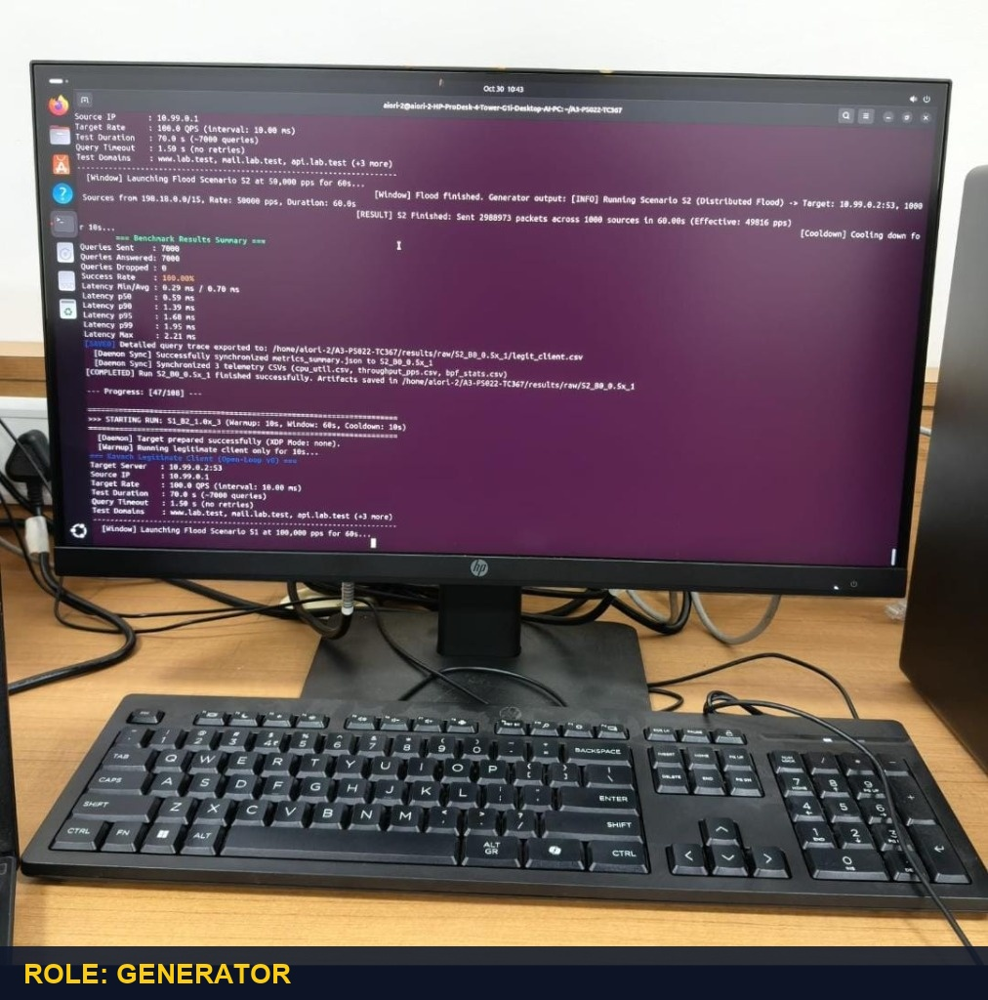
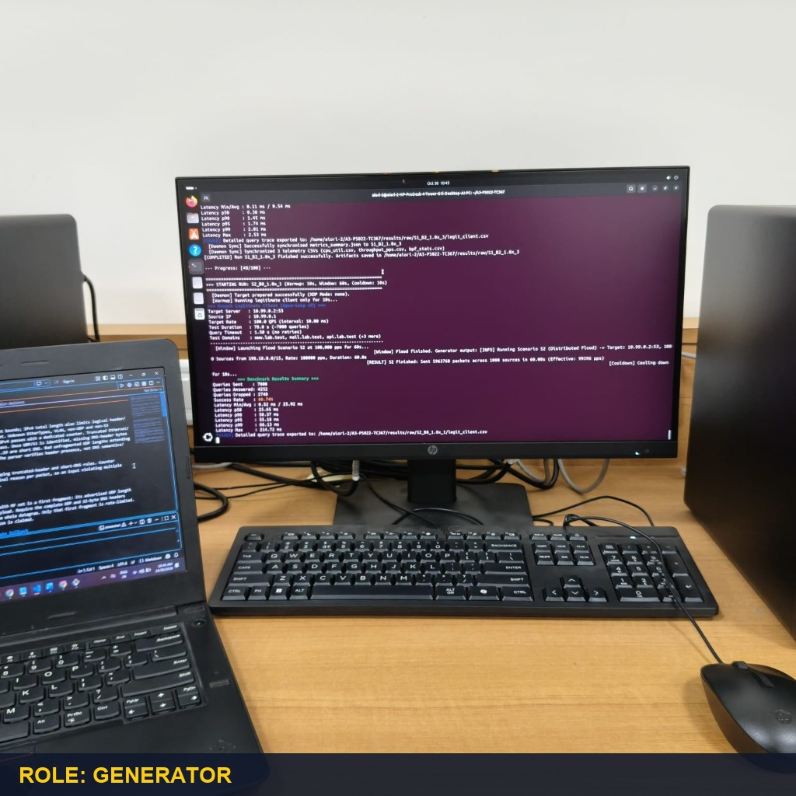
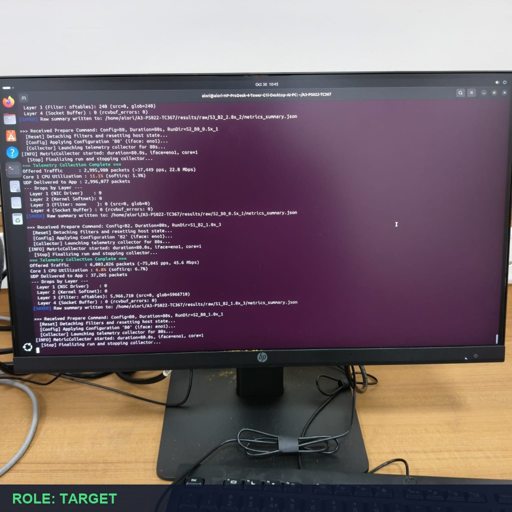
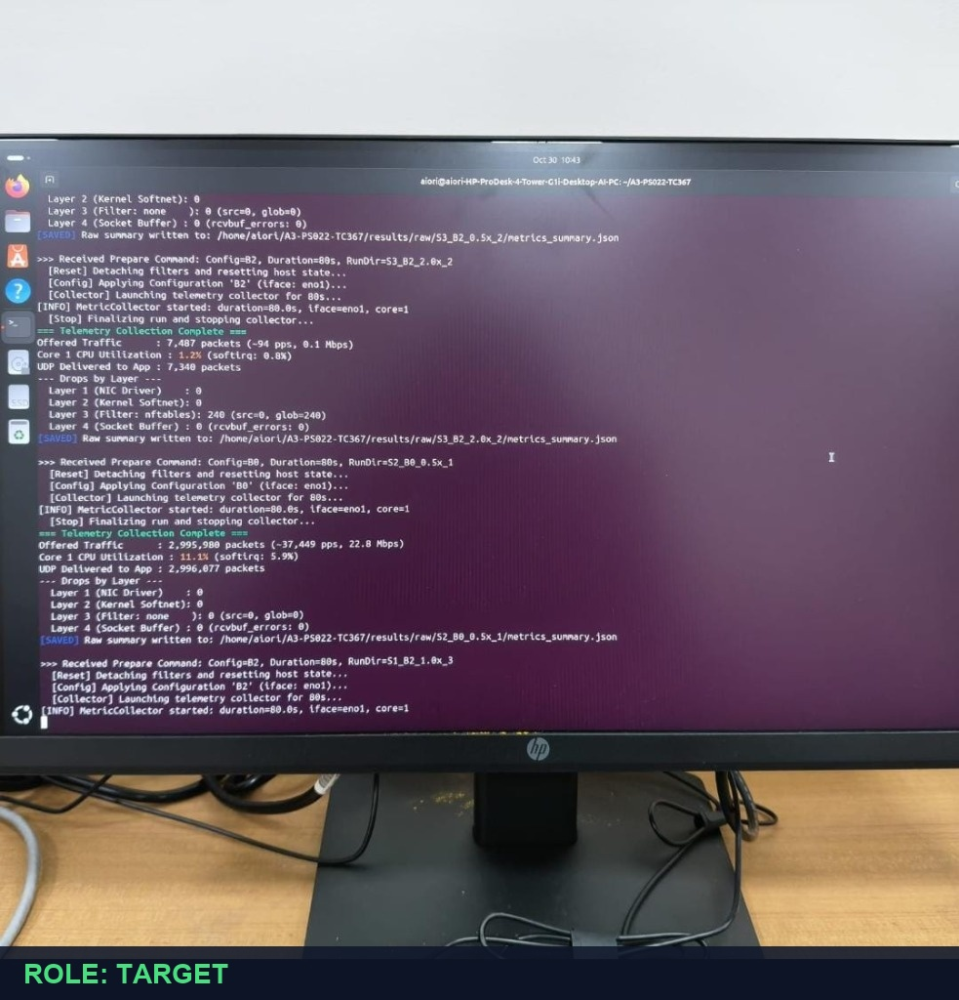
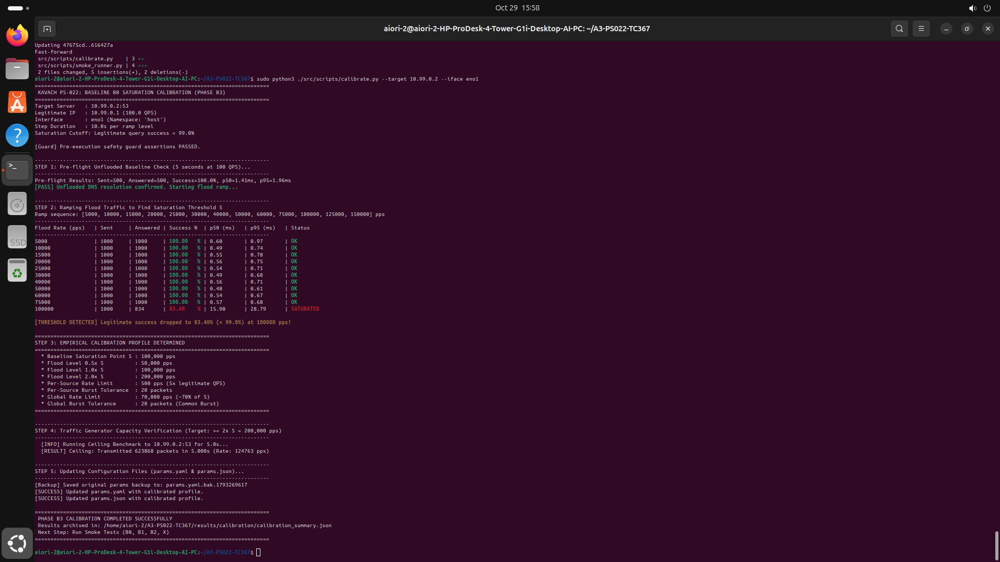

# Documentation Media & Testbed Photographic Evidence

This directory stores visual evidence, physical lab testbed photography, and runtime screenshots collected during empirical calibration and matrix benchmarking on the twin HP ProDesk 4 workstations.

---

## Physical Testbed Photographic Evidence

| Photograph | Host Role | Machine Identifier | Testbed Link |
|---|---|---|---|
| [`generator_pc2_run47_s2.jpg`](testbed_photos/generator_pc2_run47_s2.jpg) | **Generator** | PC 2 (`aiori-2-HP-ProDesk-4`, `10.99.0.1`) | Dedicated CAT6 on `eno1` |
| [`generator_pc2_run48_laptop.jpg`](testbed_photos/generator_pc2_run48_laptop.jpg) | **Generator** | PC 2 (`aiori-2-HP-ProDesk-4`, `10.99.0.1`) | Dedicated CAT6 on `eno1` |
| [`target_pc1_daemon_drops.jpg`](testbed_photos/target_pc1_daemon_drops.jpg) | **Target** | PC 1 (`aiori-HP-ProDesk-4`, `10.99.0.2`) | Dedicated CAT6 on `eno1` |
| [`target_pc1_daemon_setup.jpg`](testbed_photos/target_pc1_daemon_setup.jpg) | **Target** | PC 1 (`aiori-HP-ProDesk-4`, `10.99.0.2`) | Dedicated CAT6 on `eno1` |

---

### 1. Generator Workstation (PC 2 — `10.99.0.1`)

#### Photo 1: Generator PC Console (Run S2 Baseline)

#### Photo 2: Generator PC Console with Operator Station

---

### 2. Target Workstation — Receiver & XDP Filter (PC 1 — `10.99.0.2`)

#### Photo 3: Target PC Console (Telemetry & Layer 3 Drops)

#### Photo 4: Target PC Console (Daemon Execution & Setup)

---

## Runtime Calibration Screenshots

#### Calibration Run Snapshot (PC 2 Saturation Sweep)

